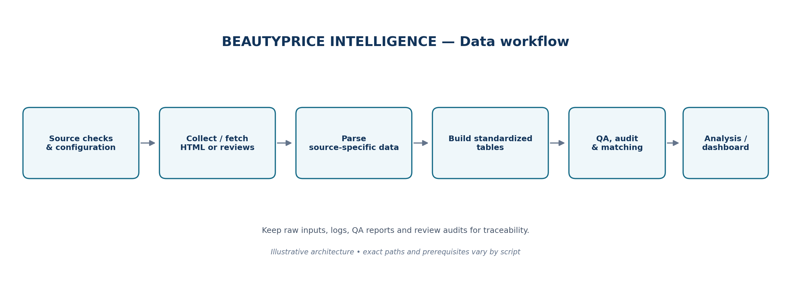
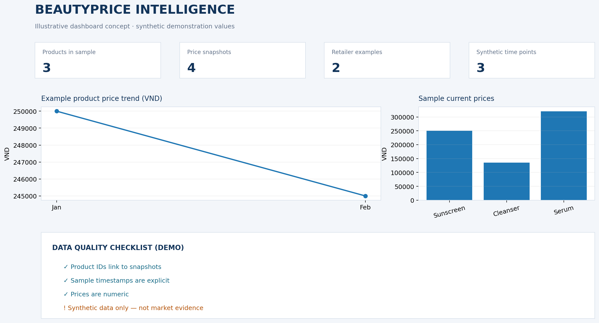

# BEAUTYPRICE INTELLIGENCE

**Dự án thu thập, chuẩn hóa, kiểm tra và phân tích dữ liệu sản phẩm, giá bán và đánh giá mỹ phẩm từ các website bán lẻ tại Việt Nam.**

BeautyPrice Intelligence tổ chức dữ liệu theo nguồn bán lẻ và nhóm sản phẩm, hỗ trợ làm sạch, kiểm tra chất lượng, chuẩn hóa bảng dữ liệu và chuẩn bị dữ liệu phục vụ phân tích. Trạng thái thực tế của từng collector phải được xác minh bằng cách chạy thử và kiểm tra log/QA; sự tồn tại của mã nguồn hoặc file trong ZIP không đồng nghĩa quy trình đã chạy thành công.

## 1. Mục tiêu dự án

- Thu thập và tổ chức dữ liệu sản phẩm mỹ phẩm theo nguồn bán lẻ và nhóm sản phẩm.
- Chuẩn hóa thông tin sản phẩm và dữ liệu giá để hỗ trợ theo dõi lịch sử giá, so sánh giữa các nguồn.
- Thu thập và làm sạch đánh giá sản phẩm ở những nguồn có quy trình tương ứng.
- Tạo báo cáo QA để nhận diện dữ liệu thiếu, bản ghi bị loại, xung đột và các vấn đề cần rà soát.
- Xây dựng bảng dữ liệu dùng chung phục vụ phân tích, EDA và dashboard.
- Ghi nhận trạng thái thu thập, lỗi và kết quả xử lý để có thể kiểm tra lại.

## 2. Nguồn dữ liệu và phạm vi sản phẩm

Trong `config/sources.json` của gói ZIP, các trạng thái được khai báo như sau:

- **Hasaki:** `existing_pipeline`.
- **Guardian, Beauty Box và Watsons:** `candidate_not_yet_validated`.


Các nhóm sản phẩm được đề cập trong mã nguồn bao gồm:

- Kem chống nắng
- Sữa rửa mặt
- Serum
- Tẩy trang
- Tẩy tế bào chết
- Sữa tắm

Mức độ hỗ trợ khác nhau theo nguồn và danh mục. Cần kiểm tra đúng script, input và output trước mỗi lần chạy.

## 3. Cấu trúc dự án

```text
BEAUTYPRICE_INTELLIGENCE/
├── app/                         # Khu vực ứng dụng
├── config/
│   └── sources.json             # Cấu hình nguồn dữ liệu
├── dashboard/                   # Khu vực dashboard
├── data/
│   ├── raw/                     # HTML và dữ liệu thô
│   ├── interim/                 # CSV trung gian, review thô và QA theo nguồn
│   └── processed/               # Bảng đã xử lý và chuẩn hóa
├── docs/
│   ├── data_dictionary.md       # Từ điển dữ liệu
│   ├── dashboard_mockup.png     # Hình phác thảo dashboard
│   └── pipeline.png             # Sơ đồ quy trình
├── notebooks/                   # Notebook phân tích
├── output/
│   ├── logs/                    # Nhật ký vận hành
│   └── reports/                 # Báo cáo QA và báo cáo tổng hợp
├── src/
│   ├── collectors/              # Collector dữ liệu sản phẩm/review và công cụ chẩn đoán
│   ├── parsers/                 # Fetcher HTML và parser tạo CSV/QA
│   └── processing/              # Chuẩn hóa, đối sánh, log và làm sạch review
├── tests/                       # Kiểm tra và chẩn đoán
├── requirements.txt             # Thư viện Python được khai báo
└── README.md
```

Đây là cấu trúc logic của dự án; tên thư mục con và file thực tế có thể thay đổi theo phiên bản. Dự án **không sử dụng thư mục `data/sample`** và không yêu cầu tạo dữ liệu mẫu.

## 4. Quy trình xử lý dữ liệu

Luồng tổng quát:

1. **Xác minh nguồn và đầu vào:** kiểm tra cấu hình, quyền truy cập, URL, đường dẫn, định dạng và điều kiện chạy.
2. **Fetch/collect:** lấy HTML sản phẩm hoặc dữ liệu đánh giá theo nguồn và danh mục.
3. **Parse:** chuyển HTML thành CSV sản phẩm; kiểm tra QA, rejected cards, report hoặc page validation nếu script tạo các file này.
4. **Lưu dữ liệu trung gian:** tổ chức dữ liệu theo nguồn/danh mục trong `data/interim/`.
5. **Build bảng chuẩn:** tạo bảng sản phẩm, liên kết danh mục và lịch sử giá khi đầu vào bắt buộc đã sẵn sàng.
6. **Các bước hỗ trợ độc lập:** tạo danh mục nhà bán lẻ, đối sánh sản phẩm và tổng hợp nhật ký thu thập.
7. **Làm sạch review:** tạo file clean, audit và quality report cho nguồn có quy trình tương ứng.
8. **Kiểm tra thủ công và phân tích:** chỉ dùng dữ liệu đã được kiểm tra cho EDA/dashboard.



Không phải mọi nguồn đều chạy qua cùng một chuỗi. Một số collector review đọc trực tiếp `products.csv`/`product_categories.csv`; một số parser cần HTML đầu vào. Các bước build không tự động chạy collector. Luôn xem phần cấu hình input/output trong đúng script.

## 5. Các bảng dữ liệu dùng chung

Các script xử lý hướng đến những bảng sau trong `data/processed/`:

| Tệp | Vai trò |
|---|---|
| `products.csv` | Danh mục sản phẩm đã chuẩn hóa, gồm thông tin định danh, nguồn và URL sản phẩm. |
| `product_categories.csv` | Liên kết sản phẩm với danh mục và nguồn gán danh mục. |
| `price_snapshots.csv` | Ảnh chụp giá theo lần thu thập, giữ lịch sử theo thời điểm. |
| `retailers.csv` | Danh mục nhà bán lẻ/website và thông tin trạng thái. |
| `product_matching.csv` | Kết quả/nhóm đối sánh sản phẩm giữa các nguồn. |
| `product_matching_review.csv` | Danh sách ứng viên đối sánh cần rà soát thủ công; không mặc định là kết quả đã xác nhận. |
| `collection_logs.csv` | Nhật ký thu thập đã chuẩn hóa từ các log hiện có. |

Dữ liệu review thô thường nằm dưới `data/interim/<source>/...`; review đã làm sạch có thể được ghi dưới `data/processed/hasaki_reviews/` hoặc `data/processed/guardian_reviews/`, tùy script. Không giả định schema review của các nguồn giống nhau: hãy kiểm tra header trước khi nối dữ liệu.

Các báo cáo thường gặp trong `output/reports/` gồm:

- `beautyprice_input_report.csv`: tình trạng/đầu vào được đọc khi build bảng chuẩn.
- `beautyprice_snapshot_conflicts.csv`: các xung đột snapshot cần điều tra.
- `hasaki_brand_summary.csv`: tổng hợp theo thương hiệu Hasaki.
- `hasaki_data_quality_issues.csv` và `hasaki_data_quality_report.txt`: các vấn đề và báo cáo chất lượng dữ liệu Hasaki.
- `parse_hasaki_log.txt`: log liên quan parser Hasaki.

Tên và vị trí output phụ thuộc vào script thực tế; kiểm tra `OUTPUT`, `OUTPUT_DIR`, `OUTPUT_FILE` và lệnh ghi file trong mã nguồn.

Tham khảo [`docs/data_dictionary.md`](docs/data_dictionary.md) để xem các trường dữ liệu đã được tài liệu hóa.

## 6. Cài đặt trên Windows

Mở PowerShell trong thư mục gốc của dự án:

```powershell
cd D:\BEAUTYPRICE_INTELLIGENCE
py --version
python --version
py -m venv .venv
.\.venv\Scripts\Activate.ps1
python -c "import sys; print(sys.executable)"
```

Đường dẫn Python đang chạy nên trỏ đến `.venv\Scripts\python.exe`. Không sao chép thư mục `.venv` từ máy khác; hãy tạo môi trường ảo mới.

Cài thư viện:

```powershell
python -m pip install --upgrade pip
python -m pip install -r requirements.txt
python -m pip install pandas
python -c "import pandas, requests, bs4, selenium; print('imports OK')"
```

Trong ZIP, `requirements.txt` liệt kê `beautifulsoup4`, `selenium` và `requests`, trong khi mã nguồn có sử dụng `pandas`. Nếu còn thiếu module khác, đọc các câu lệnh import trong đúng script rồi cài package cần thiết vào `.venv` đang kích hoạt. Không cài hàng loạt thư viện không rõ nhu cầu.

Nếu PowerShell chặn kích hoạt môi trường ảo, chỉ cân nhắc áp dụng chính sách trong phạm vi phiên hiện tại và theo quy định máy:

```powershell
Set-ExecutionPolicy -Scope Process -ExecutionPolicy Bypass
.\.venv\Scripts\Activate.ps1
```

Không tắt bảo mật toàn hệ thống chỉ để kích hoạt môi trường ảo.

## 7. Chạy các bước xử lý chính

Trước khi chạy bất kỳ script nào:
1. Mở file `.py`, đọc mô tả, đường dẫn input/output, tham số và phần `main`.
2. Xác nhận input tồn tại, đúng schema và đúng nguồn.
3. Nếu script hỗ trợ `--help`, kiểm tra tham số thực tế.
4. Chạy thử phạm vi nhỏ nếu có tham số giới hạn.
5. Kiểm tra CSV, log, QA, rejected cards, audit và quality report trước khi chuyển bước.

Các lệnh xử lý bảng chuẩn dưới đây là những bước **độc lập**, không phải lệnh chạy toàn bộ pipeline. Chạy từ thư mục gốc và chỉ khi đầu vào đã sẵn sàng:

```powershell
python src/processing/build_beautyprice_datasets.py
python src/processing/build_retailers.py
python src/processing/build_product_matching.py
python src/processing/build_collection_logs.py
```

- `build_beautyprice_datasets.py` tạo `products.csv`, `product_categories.csv`, `price_snapshots.csv` cùng báo cáo input và snapshot conflict. Script có thể dừng trước khi ghi bảng nếu kiểm tra tính toàn vẹn tham chiếu thất bại.
- `build_retailers.py` xây dựng `retailers.csv`; hãy kiểm tra retailer thực sự có trong dữ liệu, không suy ra rằng nguồn đã thu thập thành công chỉ vì có tên trong bảng.
- `build_product_matching.py` tạo bảng đối sánh và danh sách cần rà soát; xem `--help` trước khi dùng tham số tùy chọn.
- `build_collection_logs.py` tổng hợp log đã có; script này không tự khởi chạy collector hay truy cập website.
- Các script `clean_*_reviews.py` cần dữ liệu review thô phù hợp. Hãy đọc cả `*_review_audit.csv` và `review_quality_report.csv`, không chỉ xem `*_clean.csv`.

## 8. Kiểm tra chất lượng dữ liệu

Trước khi dùng dữ liệu cho phân tích, xác nhận:

- File được tạo đúng đường dẫn và thời điểm cập nhật phù hợp với lần chạy.
- CSV đọc được, có header và số cột hợp lý; file rỗng cần được điều tra.
- `product_id`, `retailer_id` và `source` có giá trị hợp lý, quan hệ khóa không bị đứt.
- `product_url` đúng URL sản phẩm, không bị thay bằng URL API hoặc trang khác ngoài dự kiến.
- Giá được parse đúng đơn vị; ngày giờ và encoding tiếng Việt không lỗi.
- Review có nội dung thực tế; ID review và ID sản phẩm khớp nếu schema có các trường này.
- Đã kiểm tra bản ghi trùng, dòng rỗng, số dòng đầu vào/đầu ra và lý do bản ghi bị loại.
- Đã đọc QA report, issues, rejected cards, audit và log, không chỉ nhìn bảng chính.
- Đã ghi lại lệnh chạy, tham số giới hạn, thời điểm, trạng thái và đường dẫn output.

Nếu CSV có 0 dòng, không kết luận ngay website không có sản phẩm/review. Hãy kiểm tra HTML, selector/widget, network/DNS, đường dẫn input/output, log và QA. Nếu build dừng, xem `beautyprice_input_report.csv`, `beautyprice_snapshot_conflicts.csv` và lỗi tính toàn vẹn tham chiếu trước khi chạy lại.

## 9. Quy tắc bảo toàn dữ liệu và an toàn

- Không dùng file có tên chứa **`Copy`** làm phiên bản chính thức. Các bản có hậu tố `(1)`, `(2)`... cũng cần so sánh nội dung trước khi chọn.
- **Không sử dụng `src/collectors/collect_thegioiskinfood_tay_trang_reviews.py`.**
- `debug_thegioiskinfood_reviews.py`, các script test/debug, file HTML/PNG diagnostic và browser profile không phải pipeline hoặc bảng dữ liệu chính.
- Không chạy hàng loạt mọi file `.py` theo thứ tự tên.
- Không chạy song song các script có thể ghi cùng một file hoặc dùng chung browser profile.
- Sao lưu CSV đang sử dụng trước khi chạy collector, parser, build hoặc clean nếu chưa xác nhận cách ghi file.
- Không sửa trực tiếp HTML/raw CSV gốc; tạo đầu ra mới có tên rõ ràng khi thử nghiệm.
- Không xóa log, QA, rejected cards, audit hoặc report vì chúng giúp giải thích chất lượng dữ liệu.
- Không nối CSV có schema khác nhau khi chưa kiểm tra và chuẩn hóa header.
- Không tạo dữ liệu giả để vượt qua kiểm tra input hoặc tính toàn vẹn tham chiếu.
- Không sao chép cookie, profile trình duyệt hoặc phiên đăng nhập sang máy mới nếu chưa đánh giá rủi ro.
- Tuân thủ điều khoản website, quyền truy cập và giới hạn hợp lý; không cố vượt qua cơ chế kiểm soát truy cập.

## 10. Bản xem trước dashboard

Hình sau là **bản phác thảo giao diện**, không phải dashboard đang hoạt động và không chứng minh rằng dữ liệu hay chỉ số đã được xác minh.



## 11. Giới hạn của dự án

- Cấu trúc website, khả năng truy cập và phản hồi có thể thay đổi.
- Trạng thái nguồn trong cấu hình không thay thế việc kiểm tra thực tế.
- So sánh giá yêu cầu xác định đúng sản phẩm, dung tích/quy cách, đơn vị tiền tệ và thời điểm ghi nhận.
- Kết quả phân tích phụ thuộc vào chất lượng và độ bao phủ của dữ liệu đầu vào.
- File đã có trong ZIP là snapshot tại thời điểm đóng gói, không chứng minh rằng chạy lại sẽ tạo đúng số dòng hoặc cùng kết quả.

## 12. Bảo mật và GitHub

Trước khi đẩy dự án lên GitHub, hãy rà soát `.gitignore`, dữ liệu trong `data/`, log, file chẩn đoán, browser profile, cookie, token, thông tin đăng nhập và các bản sao lưu. Không công khai dữ liệu cá nhân, bí mật truy cập hoặc dữ liệu chưa được đánh giá quyền sử dụng.

Dữ liệu thô, trung gian và đã xử lý nên được giữ ngoài repository theo cấu hình `.gitignore` nếu chưa có quyết định rõ ràng về quyền công bố. Chỉ đưa lên GitHub những mã nguồn và tài liệu cần thiết, đã được rà soát.

## 13. Tài liệu liên quan

- [`docs/data_dictionary.md`](docs/data_dictionary.md): từ điển dữ liệu.
- [`docs/pipeline.png`](docs/pipeline.png): sơ đồ quy trình xử lý.
- [`docs/dashboard_mockup.png`](docs/dashboard_mockup.png): bản phác thảo dashboard.
- `requirements.txt`: các thư viện Python được khai báo.
