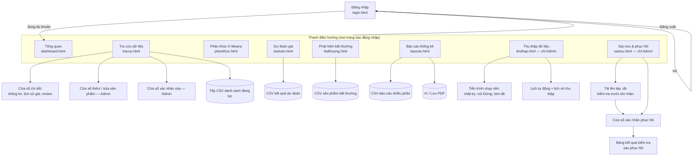
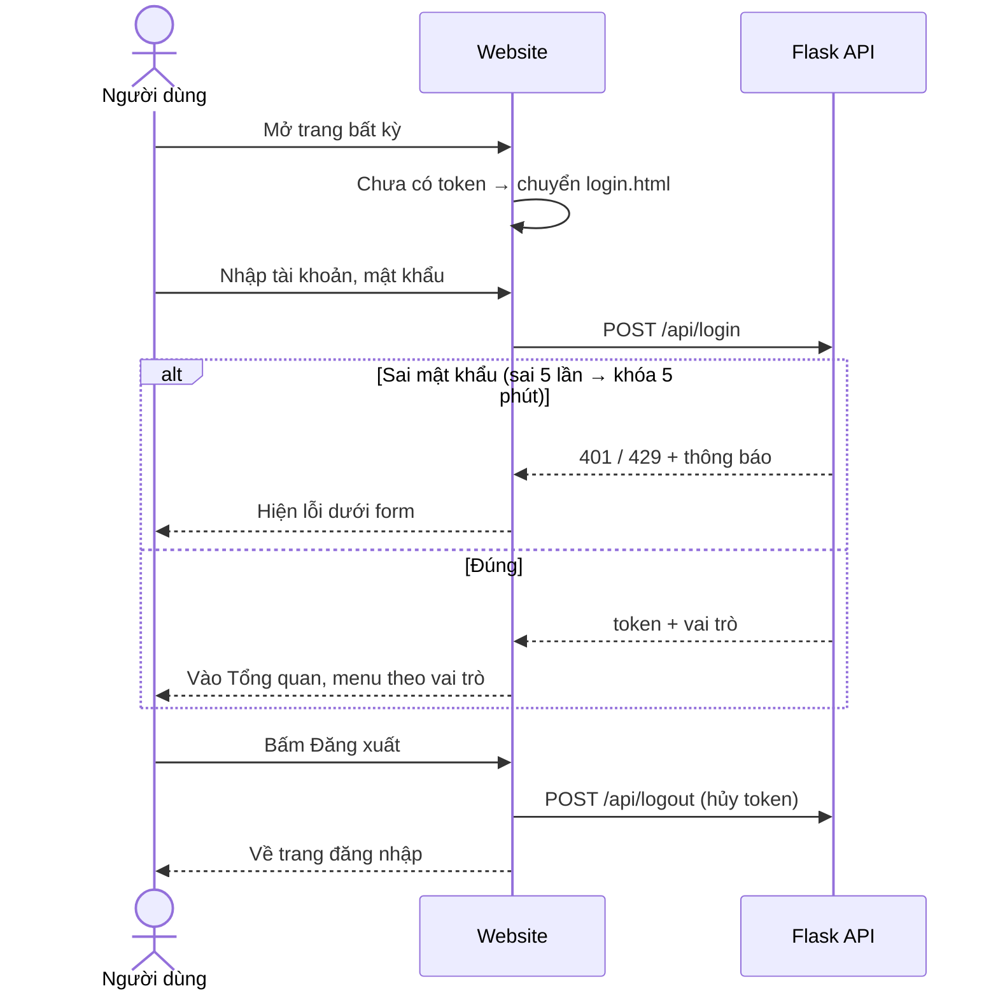
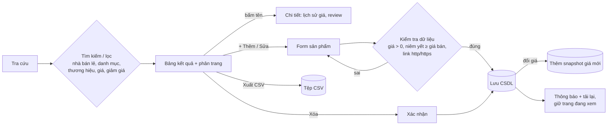
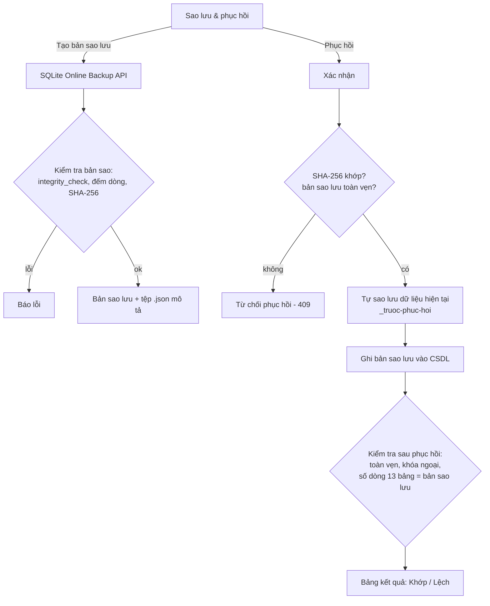
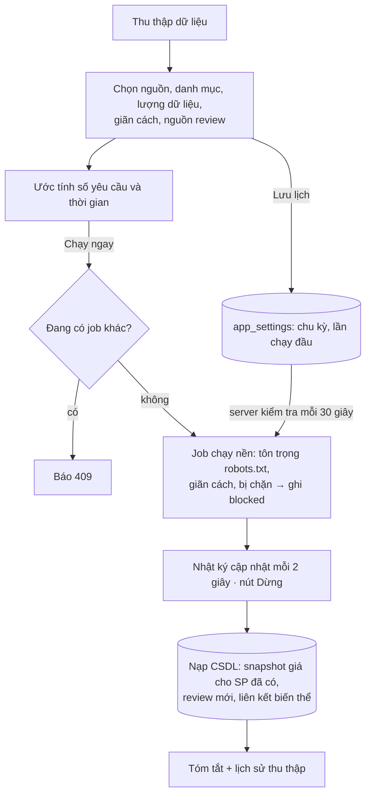
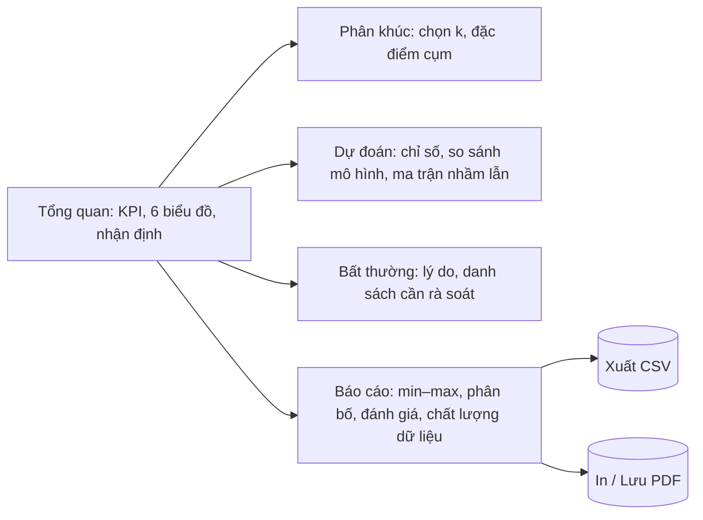

# Sơ đồ màn hình và luồng người dùng — BeautyPrice Intelligence

Tài liệu này dùng cho **Giai đoạn 8: Website GUI và chức năng cộng điểm**. Nội dung gồm:
1. Sơ đồ các màn hình và cách điều hướng giữa chúng.
2. Ma trận phân quyền.
3. Luồng người dùng cho các tác vụ chính.
4. Khung bố cục (wireframe) của từng màn hình.

Ảnh chụp thực tế của từng màn hình nằm ở `reports/demo/screens/`.

## 1. Sơ đồ màn hình



## 2. Ma trận phân quyền

| Chức năng | Khách (chưa đăng nhập) | User | Admin |
|---|:---:|:---:|:---:|
| Xem Tổng quan, Tra cứu, Phân khúc, Dự đoán, Bất thường, Báo cáo | ✗ (chuyển về đăng nhập) | ✓ | ✓ |
| Tìm kiếm, lọc, xem chi tiết và lịch sử giá | ✗ | ✓ | ✓ |
| Xuất CSV, In / Lưu PDF | ✗ | ✓ | ✓ |
| Thêm, sửa, xóa sản phẩm | ✗ | ✗ (ẩn nút; API trả 403) | ✓ |
| Thu thập dữ liệu (chạy ngay, dừng, lịch tự động) | ✗ | ✗ (ẩn menu; API trả 403) | ✓ |
| Sao lưu, tải về, tải lên, phục hồi | ✗ | ✗ (ẩn menu; API trả 403) | ✓ |
| Xem số liệu tổng trên trang đăng nhập | ✓ (chỉ số tổng) | ✓ | ✓ |

Phân quyền được kiểm tra ở **cả hai phía**: giao diện ẩn nút và menu, còn backend chặn bằng token và vai trò (`@require_auth(["Admin"])`). Nếu người dùng sửa vai trò trong trình duyệt, khi tải lại trang hệ thống vẫn lấy vai trò thật từ server (`/api/me`).

Tài khoản demo:

| Tài khoản | Mật khẩu | Vai trò |
|---|---|---|
| `admin` | `Admin@123` | Admin |
| `user` | `User@123` | User |

## 3. Luồng người dùng

### 3.1. Đăng nhập và đăng xuất


### 3.2. Tra cứu và CRUD sản phẩm (Admin)


### 3.3. Sao lưu và phục hồi (Admin)


### 3.4. Thu thập dữ liệu (Admin)


### 3.5. Xem phân tích và xuất báo cáo (User và Admin)


## 4. Khung bố cục (wireframe)

Bố cục chung của mọi trang sau khi đăng nhập:
```
┌──────────────┬───────────────────────────────────────────────────────────┐
│ ◆ BeautyPrice│  Tiêu đề trang                          [nút thao tác]    │
│              │  Mô tả ngắn                                               │
│ ▣ Tổng quan  ├───────────────────────────────────────────────────────────┤
│ ⌕ Tra cứu    │  [ Bộ lọc: nhà bán lẻ | danh mục | thương hiệu | giá ]    │
│ PHÂN TÍCH    ├──────────┬──────────┬──────────┬──────────┐              │
│ ◉ Phân khúc  │  KPI 1   │  KPI 2   │  KPI 3   │  KPI 4   │              │
│ ↗ Dự đoán    ├──────────┴──────────┼──────────┴──────────┤              │
│ ⚠ Bất thường │   Biểu đồ A         │   Biểu đồ B         │              │
│ BÁO CÁO      ├─────────────────────┼─────────────────────┤              │
│ ▤ Báo cáo    │   Biểu đồ C         │   Biểu đồ D         │              │
│ QUẢN TRỊ*    ├─────────────────────┴─────────────────────┤              │
│ ⤓ Thu thập   │   Bảng dữ liệu + phân trang / Nhận định   │              │
│ ⛁ Sao lưu    │                                           │              │
│              │                                           │              │
│ (A) admin  ⇥ │                                           │              │
└──────────────┴───────────────────────────────────────────────────────────┘
 * chỉ hiện với Admin · Màn hình < 960px: thanh điều hướng thu vào nút ☰
```

Phong cách giao diện (đồng bộ với trang đăng nhập): thanh điều hướng dạng thẻ nổi bo góc, nền tối có ánh tím/xanh và lưới mờ;
phần đầu mỗi trang là banner cùng tông (tiêu đề, mô tả, nút thao tác kiểu kính mờ); thẻ, ô nhập, nút bo tròn; khi in thì banner trở về nền trắng.

| Màn hình | Thành phần chính |
|---|---|
| **Đăng nhập** | Cột trái: logo, form (nút hiện/ẩn mật khẩu, thông báo lỗi), 2 thẻ tài khoản demo bấm để tự điền. Cột phải: khung nền tối giới thiệu hệ thống với **số liệu thật từ CSDL** (sản phẩm theo nhà bán lẻ, snapshot giá, đánh giá) và 4 tính năng chính. Điện thoại chỉ hiện form |
| **Tổng quan** | Bộ lọc → 4 KPI → doughnut tỷ trọng nhà bán lẻ, đường giá theo ngày → cột khoảng giá, cột ngang giá theo danh mục → cột chồng mức giảm, top thương hiệu → nhận định |
| **Tra cứu** | Thanh công cụ (tìm kiếm, 5 bộ lọc, sắp xếp, Xuất CSV, + Thêm) → bảng 50 dòng/trang → cửa sổ chi tiết (lịch sử giá, review có tên người đánh giá rút gọn, lọc theo sao; nếu chưa có review thì ghi rõ lý do), form thêm/sửa, xác nhận xóa |
| **Phân khúc** | 4 KPI → cột số sản phẩm theo cụm, đường silhouette theo k → bubble giá/giảm theo cụm, cột chồng nhà bán lẻ → thẻ đặc điểm cụm → đặc trưng → bảng sản phẩm |
| **Dự đoán** | Hồi quy (KPI, scatter thực tế/dự đoán, so sánh mô hình, độ quan trọng đặc trưng, MAPE theo nhóm) → phân loại (KPI, ma trận nhầm lẫn) → bảng dự đoán tập test |
| **Bất thường** | 4 KPI → scatter giá/giảm, tỷ lệ theo nhà bán lẻ → lý do bất thường, cách mô hình hoạt động, độ nhạy → bảng danh sách cần rà soát |
| **Báo cáo** | Tổng quan → min–max (theo danh mục, nhà bán lẻ, chỉ số) → phân bố → đánh giá → chất lượng dữ liệu → nhận định; nút In/PDF và Xuất CSV |
| **Thu thập dữ liệu** | 4 KPI (trạng thái, lần gần nhất, lịch, số sản phẩm/snapshot) → tùy chọn (nguồn, danh mục, số trang, giãn cách, số sản phẩm/trang review, nguồn review, mẫu nhanh, ước tính) + khung tiến trình (nhật ký, tóm tắt) → lịch tự động → lịch sử thu thập → nguyên tắc thu thập |
| **Sao lưu & phục hồi** | 4 KPI trạng thái CSDL → vùng kéo thả tải lên tệp `.db` → danh sách bản sao lưu (tải về, phục hồi; nhãn "Tải lên") → bảng kết quả kiểm tra sau phục hồi → mô tả quy trình |
