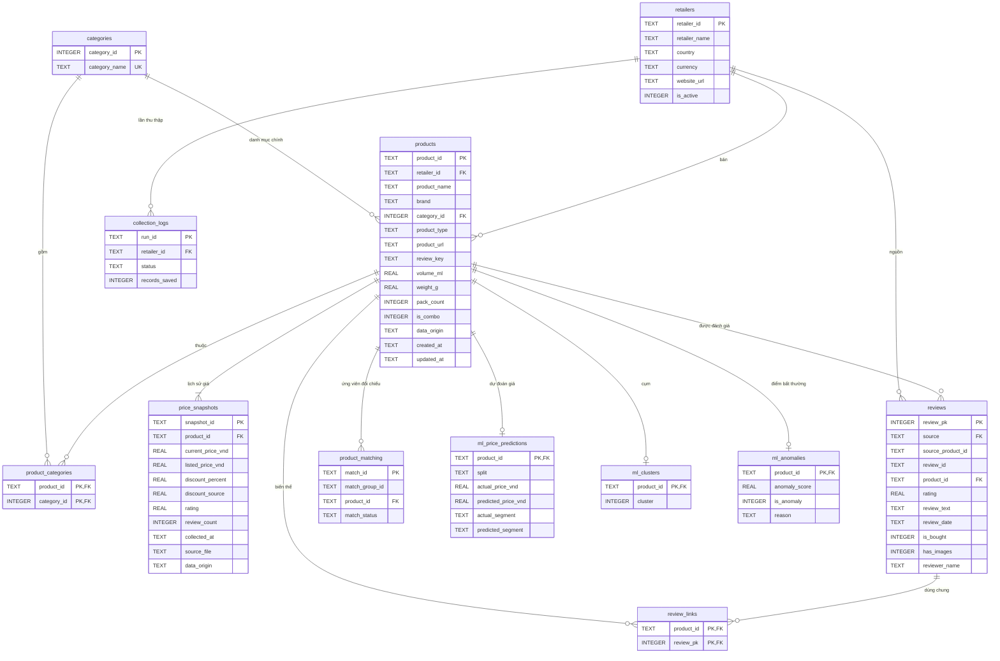
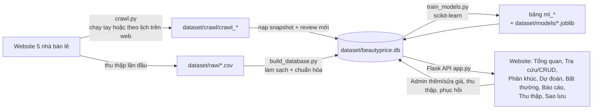

# Thiết kế cơ sở dữ liệu — BeautyPrice Intelligence

- **Hệ quản trị CSDL:** SQLite 3. CSDL là file `dataset/beautyprice.db`.
- **Lược đồ:** [`source-code/pipeline/schema.sql`](../source-code/pipeline/schema.sql).
- **Chương trình dựng CSDL:** [`source-code/pipeline/build_database.py`](../source-code/pipeline/build_database.py).

## 1. Lý do chọn SQLite

| Tiêu chí | SQLite |
|---|---|
| Cài đặt | Không cần cài. Python có sẵn module `sqlite3`. |
| Mang sang máy khác | Toàn bộ CSDL là 1 file (khoảng 9,3 MB). Chép thư mục dự án là chạy được. |
| Đủ cho bài toán | 5.657 sản phẩm, 6.350 snapshot giá, 6.673 review (dữ liệu gốc), 1–2 người dùng ghi đồng thời. |
| Tính năng CSDL quan hệ | Khóa chính, khóa ngoại (`ON DELETE CASCADE / SET NULL`), `CHECK`, `UNIQUE`, chỉ mục, view, hàm cửa sổ (`ROW_NUMBER`), transaction. |
| Chuyển sang MySQL/PostgreSQL | Lược đồ dùng SQL chuẩn. Chỉ cần đổi kiểu `AUTOINCREMENT`, cú pháp `strftime` và phần kết nối trong `app.py`. |

## 2. Sơ đồ quan hệ (ERD)



Các bảng không có quan hệ khóa ngoại:
- `users`: tài khoản và vai trò.
- `app_settings`: cấu hình hệ thống dạng khóa – giá trị JSON (hiện dùng cho lịch thu thập tự động).
- `etl_log`: nhật ký làm sạch dữ liệu và các lần nạp dữ liệu thu thập.
- `ml_runs`: các lần huấn luyện, tham số và chỉ số đánh giá.
- `ml_feature_importance`: độ quan trọng của đặc trưng.

## 3. Từ điển dữ liệu và quy tắc nghiệp vụ

### retailers — nhà bán lẻ (5 dòng)
Gồm Cocolux, Guardian, Hasaki, Thế Giới Skin Food, Watsons. Khóa `retailer_id` là chuỗi viết thường, ví dụ `hasaki`. CSV gốc ghi tên không dấu "The Gioi Skin Food"; bước nạp đổi sang tên hiển thị có dấu.

### categories — danh mục (6 dòng)
Gồm Kem chống nắng, Serum, Sữa rửa mặt, Sữa tắm, Tẩy trang, Tẩy tế bào chết. Tên danh mục là `UNIQUE`.

### products — sản phẩm (listing)
Mỗi dòng là **một sản phẩm tại một nhà bán lẻ**. Cùng một sản phẩm bán ở 2 nơi là 2 dòng; việc đối chiếu chúng nằm ở bảng `product_matching`.

| Cột | Kiểu | Ràng buộc / quy tắc |
|---|---|---|
| `product_id` | TEXT | Khóa chính: `prod_` + 16 ký tự đầu của SHA-256(`<nhà bán lẻ>|<URL>`). Cùng công thức cho dữ liệu gốc và crawler, nên lần thu thập sau tự nối đúng sản phẩm cũ |
| `retailer_id` | TEXT | Khóa ngoại → `retailers`, bắt buộc |
| `product_name` | TEXT | Bắt buộc, 1–300 ký tự. Đã chuẩn Unicode NFC, bỏ ký tự vô hình, gộp khoảng trắng |
| `brand` | TEXT | Bắt buộc. Các cách viết khác hoa/thường được gộp về cách viết phổ biến nhất |
| `category_id` | INTEGER | Khóa ngoại → `categories`. Cho phép NULL khi danh mục không rõ |
| `product_type` | TEXT | Một trong `single`, `bundle`, `multi_pack`, `unknown` |
| `product_url` | TEXT | Chỉ chấp nhận `http(s)` |
| `review_key` | TEXT | Khóa nối với review: `hasaki:<id cuối URL>` hoặc `guardian:<URL chuẩn hóa>` |
| `volume_ml`, `weight_g`, `pack_count`, `is_combo` | | Trích từ tên sản phẩm (ví dụ "400ml", "800g", "Bộ 3 món", "Combo") |
| `data_origin` | TEXT | `scraped` (thu thập) hoặc `manual` (admin thêm) |

### price_snapshots — lịch sử giá
Mỗi lần thu thập, hoặc mỗi lần admin đổi giá, sinh **một dòng mới**. **Giá hiện tại** của sản phẩm là snapshot mới nhất (xem view `v_latest_snapshot`).

| Cột | Ràng buộc / quy tắc |
|---|---|
| `current_price_vnd` | `> 0` |
| `listed_price_vnd` | NULL hoặc `>= current_price_vnd`. Nếu giá niêm yết nhỏ hơn giá bán thì bỏ (NULL) |
| `discount_percent` | `= (niêm yết − bán) / niêm yết × 100`, làm tròn 2 chữ số. NULL khi không có giá niêm yết (không đoán) |
| `discount_source` | Giá trị % giảm gốc trên website, giữ lại để truy vết |
| `rating` | NULL hoặc trong khoảng 0–5. Rating = 0 nghĩa là "chưa có đánh giá" nên được ghi NULL |
| `review_count` | NULL hoặc `>= 0` |

### reviews — đánh giá của khách hàng
- `UNIQUE (source, source_product_id, review_id)` để loại trùng.
- `rating` nằm trong khoảng 1–5 và **giữ nửa sao** (Guardian có các mức 4.5, 3.5, 2.5).
- `review_date` được chuẩn hóa về ISO 8601 từ 2 định dạng gốc: "2025-09-27 17:17:59" và "22 tháng 4, 2025". Giá trị gốc được giữ ở `review_date_raw`.
- `product_id` được nối theo ID nguồn. Khi sản phẩm bị xóa thì cột này về NULL (`ON DELETE SET NULL`); review vẫn được giữ.
- `reviewer_name`: tên người đánh giá **chỉ lưu dạng rút gọn** ("Nguyễn Văn An" → "Nguyễn V. A.", tên tài khoản → "N***"); tên giống email/số điện thoại bị bỏ. Không lưu mã tài khoản.
- Nguồn: dữ liệu gốc (Hasaki, Guardian) và crawler (Hasaki, Cocolux qua API review công khai). Crawler chống trùng theo (nguồn, `review_id`).

### review_links — review dùng chung giữa các biến thể
Website hiện **cùng một review trên mọi biến thể** (dung tích, mùi…) của một sản phẩm. Review chỉ lưu **1 lần** trong `reviews`
(thống kê không đếm trùng); các biến thể khác được nối qua bảng này để trang Tra cứu vẫn hiện đủ review.
- Khóa chính `(product_id, review_pk)`; khóa ngoại `ON DELETE CASCADE` về cả `products` và `reviews`.
- Quy tắc: không nối review về chính sản phẩm sở hữu nó; chỉ nối sản phẩm cùng nhà bán lẻ với review (`verify_database.py` kiểm tra cả hai).

### app_settings — cấu hình
`key` (khóa chính) và `value` (JSON). Hiện có khóa `crawl_schedule`: bật/tắt lịch, chu kỳ (giờ), lần chạy kế tiếp và tùy chọn thu thập.

### users — người dùng
- `role` là `Admin` (xem, thêm, sửa, xóa) hoặc `User` (chỉ xem).
- Mật khẩu chỉ lưu dạng băm PBKDF2-SHA256.
- `build_database.py` tạo sẵn `admin` và `user` khi dựng CSDL; nếu bảng `users` trống, backend tự tạo lại khi khởi động.

### etl_log — nhật ký làm sạch
Mỗi bước làm sạch ghi lại: tên bước, bảng, số dòng vào, số dòng ra, số dòng bị tác động, ghi chú. Trang **Báo cáo** hiển thị bảng này.

### Bảng kết quả học máy (do `train_models.py` ghi)

| Bảng | Nội dung |
|---|---|
| `ml_runs` | Mỗi mô hình đã thử: tham số, chỉ số validation/test, cờ `is_selected` |
| `ml_price_predictions` | Giá dự đoán (hồi quy) và phân khúc dự đoán (phân loại) cho từng sản phẩm, kèm tập `train`/`validation`/`test` |
| `ml_clusters` | Cụm K-Means của từng sản phẩm |
| `ml_anomalies` | Điểm Isolation Forest, cờ bất thường, lý do giải thích |
| `ml_feature_importance` | Độ quan trọng đặc trưng của mô hình hồi quy và phân loại |

## 4. View

- `v_latest_snapshot`: snapshot mới nhất của mỗi sản phẩm, lấy bằng `ROW_NUMBER() OVER (PARTITION BY product_id ORDER BY collected_at DESC)`.
- `v_products`: sản phẩm + tên nhà bán lẻ + danh mục + giá mới nhất. Website đọc từ view này.

## 4b. Tách bảng (reference) hay gộp (embed): lựa chọn theo cách truy vấn

Nếu dùng MongoDB, mỗi quan hệ sẽ phải chọn giữa **nhúng (embed)** dữ liệu con vào document cha, hoặc **tham chiếu (reference)** sang collection khác bằng khóa. Với SQLite, câu hỏi tương ứng là **tách thành bảng riêng nối bằng khóa ngoại** (reference), hay **gộp cột vào cùng bảng / đọc qua view phẳng** (embed). Mỗi lựa chọn dưới đây dựa trên cách website và mô hình thực sự truy vấn:

| Quan hệ | Lựa chọn | Lý do (theo truy vấn và quan hệ dữ liệu) |
|---|---|---|
| Sản phẩm → **lịch sử giá** (1–N, tăng liên tục) | **Reference**: bảng `price_snapshots` riêng | Mỗi lần thu thập hoặc admin đổi giá lại sinh thêm snapshot (dữ liệu gốc 6.350 dòng, tăng sau mỗi lần thu thập). Nhúng vào sản phẩm sẽ làm bản ghi phình mãi. Ngoài ra cần truy vấn riêng lịch sử giá theo ngày (biểu đồ xu hướng, Q5 trong `queries.sql`) và lấy "giá mới nhất" bằng `ROW_NUMBER()` |
| Sản phẩm → **nhà bán lẻ** (N–1, chỉ 5 dòng, ít đổi) | **Reference**: `products.retailer_id` → `retailers` | Thông tin nhà bán lẻ (tên, website) dùng chung cho hàng nghìn sản phẩm. Tách bảng thì sửa một chỗ là đủ. View `v_products` "nhúng" sẵn tên nhà bán lẻ khi đọc |
| Sản phẩm ↔ **danh mục** (N–N) | **Reference**: bảng nối `product_categories`; danh mục chính lưu ở `products.category_id` | Một sản phẩm có thể thuộc nhiều danh mục (6.350 cặp cho 5.657 sản phẩm: 569 sản phẩm thuộc 2–4 danh mục). Lọc theo danh mục là thao tác chính trên website, nên cần chỉ mục trên bảng nối |
| Sản phẩm → **review** (1–N, 6.673 dòng, văn bản dài) | **Reference**: `reviews.product_id` (cho phép NULL) | Review đến từ nguồn khác (Hasaki, Guardian, Cocolux), nối bằng ID nguồn, có 85 review chưa nối được với sản phẩm nào. Review cũng được thống kê độc lập theo nguồn (Q6). Xóa sản phẩm thì review vẫn giữ (`ON DELETE SET NULL`) |
| Review ↔ **biến thể** dùng chung review (N–N) | **Reference**: bảng nối `review_links` | Nhúng bản sao review vào từng biến thể sẽ đếm trùng khi thống kê; bảng nối giữ mỗi review 1 lần mà biến thể nào cũng xem được |
| Giá mới nhất, % giảm, rating hiện tại | **Embed khi đọc**: view `v_products` | Gần như mọi màn hình chỉ cần "sản phẩm + giá hiện tại". View trả về một bản ghi phẳng như document đã nhúng, mà không phải lưu trùng dữ liệu |
| Thuộc tính trích từ tên (ml, g, số món, combo) | **Embed**: cột trong `products` | Quan hệ 1–1, luôn đọc cùng sản phẩm (đặc trưng cho mô hình), không có vòng đời riêng |
| Kết quả mô hình (dự đoán, cụm, bất thường) | **Reference**: các bảng `ml_*` khóa theo `product_id` | Được ghi lại toàn bộ mỗi lần huấn luyện. Tách bảng thì huấn luyện lại không phải sửa bảng sản phẩm |
| Nhật ký thu thập, nhật ký làm sạch | **Bảng riêng** `collection_logs`, `etl_log` | Dữ liệu vận hành, chỉ ghi thêm; truy vấn để báo cáo chất lượng dữ liệu |

### Ánh xạ dữ liệu thu thập → bảng

| Tệp CSV (`dataset/raw/`) | Bảng | Ghi chú |
|---|---|---|
| `products (1).csv` | `products` | Chuẩn hóa tên, gộp thương hiệu, trích thuộc tính |
| `price_snapshots (1).csv` | `price_snapshots` | Giá theo website và thời điểm; tính lại % giảm |
| `retailers.csv` | `retailers` | 5 nhà bán lẻ |
| `product_categories (2).csv` | `categories`, `product_categories` | Quan hệ N–N |
| `product_matching.csv` | `product_matching` | Ứng viên đối chiếu sản phẩm giữa các website |
| `collection_logs.csv` | `collection_logs` | Lịch sử các lần thu thập |
| `hasaki_reviews.csv`, `guardian_reviews.csv` | `reviews` | Đánh giá hợp lệ (rating 1–5, đã bỏ trùng) |
| `dataset/crawl/crawl_*/snapshots.csv` | `price_snapshots` (+ `products` nếu bật thêm sản phẩm mới) | Các lần thu thập mới bằng crawler. Mặc định chỉ thêm giá cho sản phẩm đã có, nên danh sách 5.657 sản phẩm gốc không đổi |
| `dataset/crawl/crawl_*/reviews.csv` | `reviews`, `review_links` | Review Hasaki/Cocolux do crawler thu thập |

`build_database.py` mặc định chỉ dựng từ `dataset/raw/` (khớp EDA và báo cáo); chạy kèm `--with-crawl` để nạp lại cả các lần thu thập trong `dataset/crawl/`.

### Script import, truy vấn mẫu và kiểm tra

| Tệp | Nội dung |
|---|---|
| `source-code/pipeline/schema.sql` | Tạo bảng, khóa, ràng buộc CHECK, chỉ mục, view |
| `source-code/pipeline/build_database.py` | Import + làm sạch; in số bản ghi từng bảng; ghi `etl_log` |
| `source-code/pipeline/queries.sql` | 7 truy vấn mẫu: find, filter, projection, sort, limit, aggregation, lookup. Mỗi truy vấn kèm cú pháp MongoDB tương đương |
| `source-code/pipeline/verify_database.py` | Kiểm tra số bản ghi sau import (CSV so với CSDL), toàn vẹn, khóa ngoại; đối chiếu kết quả truy vấn với phép tính độc lập bằng Python thuần |
| `reports/KIEM_TRA_CSDL.md` | Kết quả kiểm tra (tự sinh khi chạy `verify_database.py`) |

## 5. Luồng dữ liệu



## 6. Ví dụ truy vấn

```sql
-- Số sản phẩm, giá min / max / trung bình theo nhà bán lẻ (giá hiện tại)
SELECT source, COUNT(*) AS so_sp, MIN(current_price_vnd) AS min_gia, MAX(current_price_vnd) AS max_gia,
       ROUND(AVG(current_price_vnd)) AS gia_tb
FROM v_products GROUP BY source ORDER BY gia_tb DESC;

-- Sản phẩm có biến động giá qua các lần thu thập
SELECT p.product_name, COUNT(*) AS so_lan, MIN(s.current_price_vnd) AS thap_nhat, MAX(s.current_price_vnd) AS cao_nhat
FROM price_snapshots s JOIN products p USING (product_id)
GROUP BY s.product_id HAVING MAX(s.current_price_vnd) > MIN(s.current_price_vnd)
ORDER BY (MAX(s.current_price_vnd) - MIN(s.current_price_vnd)) * 1.0 / MIN(s.current_price_vnd) DESC LIMIT 10;

-- Điểm review trung bình theo sản phẩm (đã nối theo ID nguồn)
SELECT p.product_name, COUNT(r.review_pk) AS so_review, ROUND(AVG(r.rating), 2) AS diem_tb
FROM reviews r JOIN products p USING (product_id) GROUP BY r.product_id ORDER BY so_review DESC LIMIT 10;

-- Review của một sản phẩm, gồm cả review dùng chung từ biến thể khác (cách API /api/reviews?product_id= làm)
SELECT r.reviewer_name, r.rating, r.review_text FROM reviews r
WHERE r.product_id = :pid OR r.review_pk IN (SELECT review_pk FROM review_links WHERE product_id = :pid);
```
